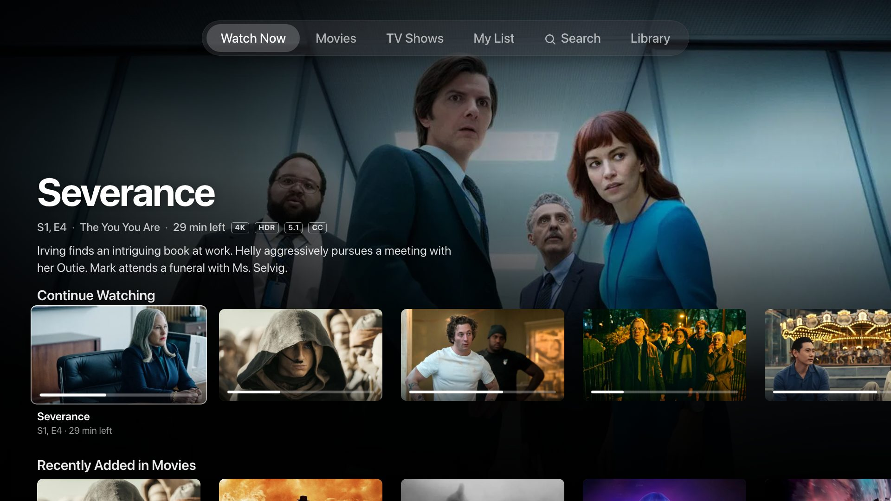
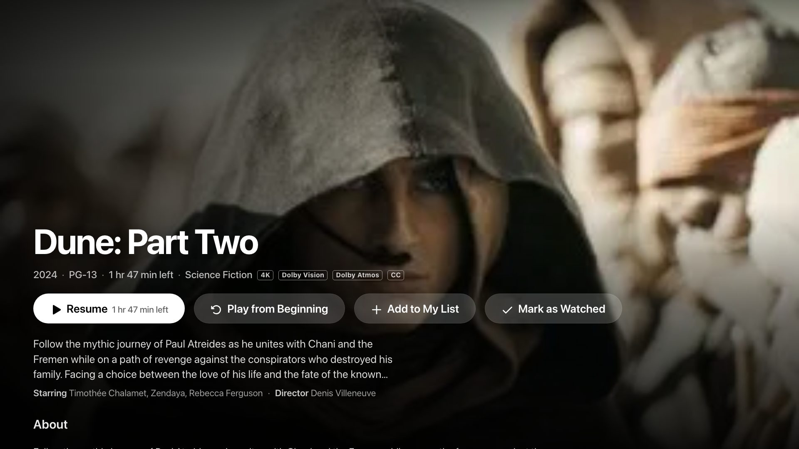
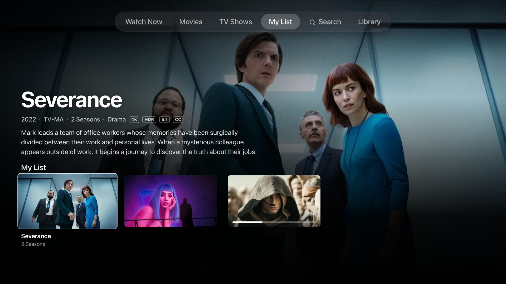
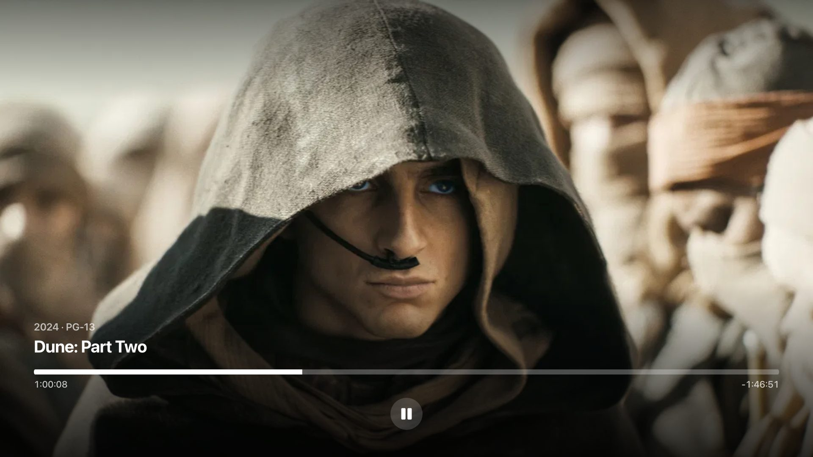
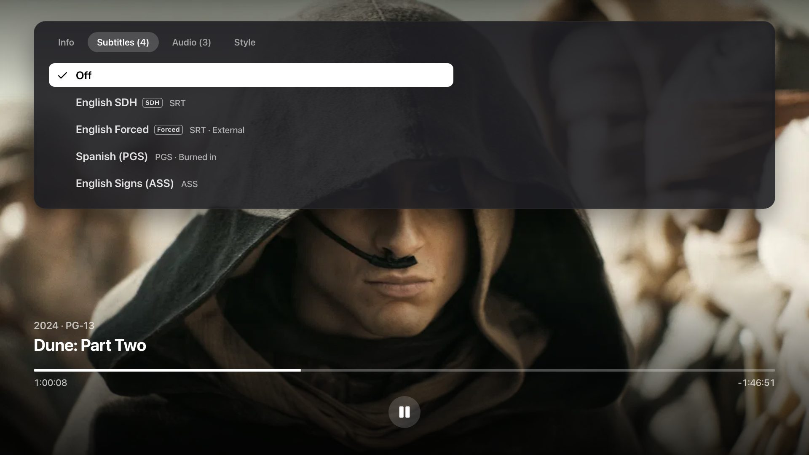
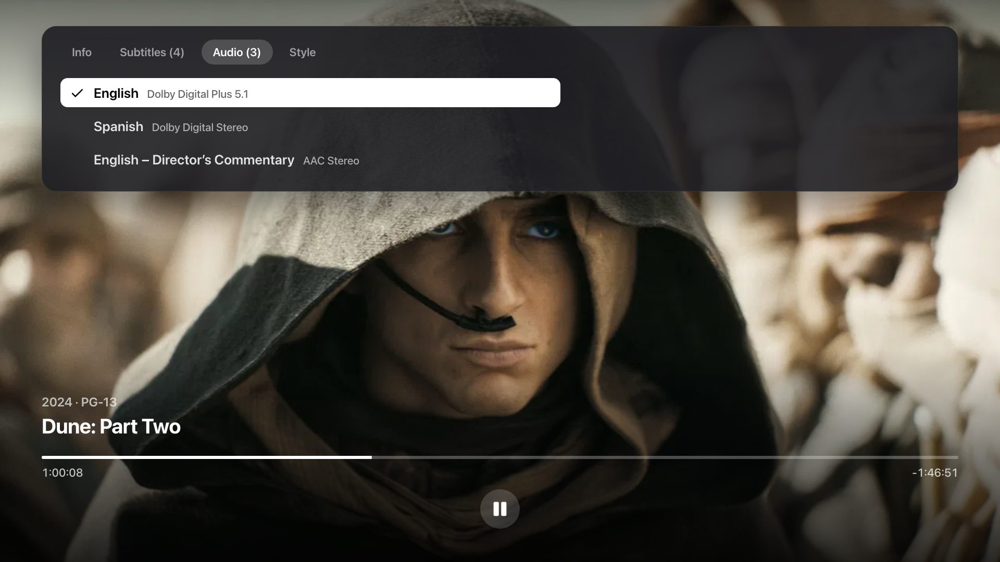

# ATV for Plex

An Apple TV–style Plex client for Samsung Tizen TVs.

Watch Now fills the screen. A title page has one obvious Play button. The player gets out of the way until you need it. Sign in with a PIN, point it at the Plex server already on your network, and use the remote you already have.



Built for Tizen 6 (Chromium 76). The layout is a fixed 1920×1080 canvas, the same size the TV panel is, so type stays sharp and nothing reflows when you sit back.

## What it does

- **Watch Now, Movies, TV Shows, Search, and Library.** Shelves, a hero, and a poster grid, driven by the server you already run.
- **A title page that knows where you left off.** Resume, start over, or mark it watched.
- **My List.** Add a movie or show from its page. The list lives on the TV and syncs to a Plex playlist named My List, so it shows up in other Plex apps too.
- **Audio and subtitles, including sidecars.** SRT, ASS, and VTT are drawn by the app. PGS and VobSub are burned in by your server, and only after you choose them. If a track cannot be loaded, the video keeps playing.
- **Subtitle style.** Font, size, color, and background, saved on the TV.
- **Direct play when the TV can take the file.** H.264 or HEVC in MP4, MKV, or MPEG-TS, with AAC, AC3, E-AC3, or MP3. Anything else is transcoded by your Plex server to 1080p H.264.

| | |
| --- | --- |
|  |  |
|  |  |

Audio tracks sit next to subtitles. Commentary, stereo, and surround are all selectable.



## Requirements

- A Samsung TV on Tizen 6.0 or newer. That is most sets from 2021 onward, and some from 2020. It was built against a 2021 QN55Q70A.
- Plex Media Server, reachable from the TV on your LAN.
- A Plex account. Sign-in is a PIN at [plex.tv/link](https://plex.tv/link). The TV never asks for your password.

## Look at it before you install anything

Preview mode is the real interface with sample posters. It does not contact Plex, and it does not play video.

```bash
python3 -m http.server 8080
```

Open [http://127.0.0.1:8080/index.html?preview=1](http://127.0.0.1:8080/index.html?preview=1).

Useful routes, all with `?preview=1`:

| URL | Screen |
| --- | --- |
| `&screen=home` | Watch Now |
| `&screen=movies` | Movies |
| `&screen=tv` | TV Shows |
| `&screen=list` | My List |
| `&screen=search&q=dune` | Search |
| `&screen=library` | Library |
| `&screen=detail&item=m693134` | A title page |
| `&screen=player&item=m693134` | The player |
| `&screen=player&item=m693134&panel=subtitles` | Subtitle chooser |
| `&screen=player&item=m693134&panel=audio` | Audio chooser |
| `&screen=login` | PIN sign-in |

The posters and plot lines in preview mode were collected from public TMDB pages so the screenshots above could be taken. They are not shipped as a library, and they are not what the TV plays. On a television, every row comes from your Plex server.

## Install it on the TV

Samsung only installs a package signed with a certificate that names your set. There is no one file that works on every TV, so the signed package is not in this repo. You make one for yours.

1. On the TV, open **Apps**, highlight **App Settings**, and enter `12345` on the remote. Turn **Developer Mode** on and restart the TV. Note the TV’s IP address.
2. Install [Tizen Studio](https://developer.tizen.org/development/tizen-studio/download) (the CLI tools are enough) and the Samsung TV extension.
3. In Certificate Manager, create a Samsung certificate and add this TV’s DUID to it. Name the profile whatever you like. The steps below call it `YOUR_PROFILE`.
4. Package the app from this directory. `tizen` is `tools/ide/bin/tizen` inside Tizen Studio.

```bash
rm -rf /tmp/atv-pack && mkdir -p /tmp/atv-pack/app
cp config.xml icon.png index.html /tmp/atv-pack/app/
cp -R css js /tmp/atv-pack/app/
tizen package -t wgt -s YOUR_PROFILE -o /tmp/atv-pack -- /tmp/atv-pack/app
```

The widget file is named after the app, so you get `/tmp/atv-pack/ATV for Plex.wgt`.

5. Install it. `sdb` lives in Tizen Studio’s `tools` directory. `sdb install` only copies the file onto the TV. The command that actually installs it is `vd_appinstall`, and the file on the TV has to be named `package.wgt`.

```bash
sdb connect TV_IP:26101
sdb -s TV_IP:26101 push "/tmp/atv-pack/ATV for Plex.wgt" /home/owner/share/tmp/sdk_tools/package.wgt
sdb -s TV_IP:26101 shell 0 vd_appinstall AtvPlex001 /home/owner/share/tmp/sdk_tools/package.wgt
sdb -s TV_IP:26101 shell 0 execute AtvPlex001.Atv
```

Port `26101` is the usual developer port. If the connection is refused, the TV is asleep or Developer Mode is off.

Open **ATV for Plex**, enter the PIN at [plex.tv/link](https://plex.tv/link), and pick your server. The app id is `AtvPlex001.Atv`, so later builds replace the one already on the TV.

## How playback is chosen

A file plays directly when the video is H.264 or HEVC, the audio is AAC, AC3, E-AC3, or MP3, and the container is MP4, MKV, or MPEG-TS. That path is the original file from your server. No transcode.

Anything else goes through Plex’s universal transcoder as HLS, capped at 1080p and 20 Mbps, with a client profile that only asks for codecs Tizen 6 can decode. If direct play fails on the TV, the app retries once through that transcoder.

Text subtitles are fetched from the server and painted over the picture, so turning them on does not force a transcode. Image subtitles cannot be painted that way. Choosing one asks the server to burn it in. If that burn fails, the app drops the track and keeps the video going.

Progress is reported back to Plex, so Resume lines up with your other players.

## Project layout

```
config.xml     Tizen widget (Tizen 6, package AtvPlex001)
index.html     screens
css/app.css    the 1920×1080 layout
js/app.js      tabs, remote, boot
js/views.js    shelves, search, library, title page
js/player.js   AVPlay, transport, subtitles
js/plex.js     PIN sign-in, library API, playback URLs
js/cache.js    last-seen shelves, so Watch Now paints immediately
js/util.js     shared helpers and icons
js/sample.js   preview posters (TMDB). Not used on the TV.
js/preview.js  preview data source. Not used on the TV.
```

The scripts are ES5. Tizen 6’s browser is Chromium 76, so there are no modules and no newer syntax. Icons are [Phosphor](https://phosphoricons.com), MIT.

## This is not Apple, and it is not Plex

ATV for Plex is an independent project. Apple does not make it, Plex does not make it, and Samsung does not make it. None of them endorse it.

Apple TV is a trademark of Apple Inc. Plex is a trademark of Plex, Inc. Samsung and Tizen are trademarks of their owners. The name describes the kind of interface this is: a Plex client, for Samsung Tizen, laid out the way a living-room TV interface should be.

## License

[MIT](LICENSE). Copyright 2026 Izazzubayer.
